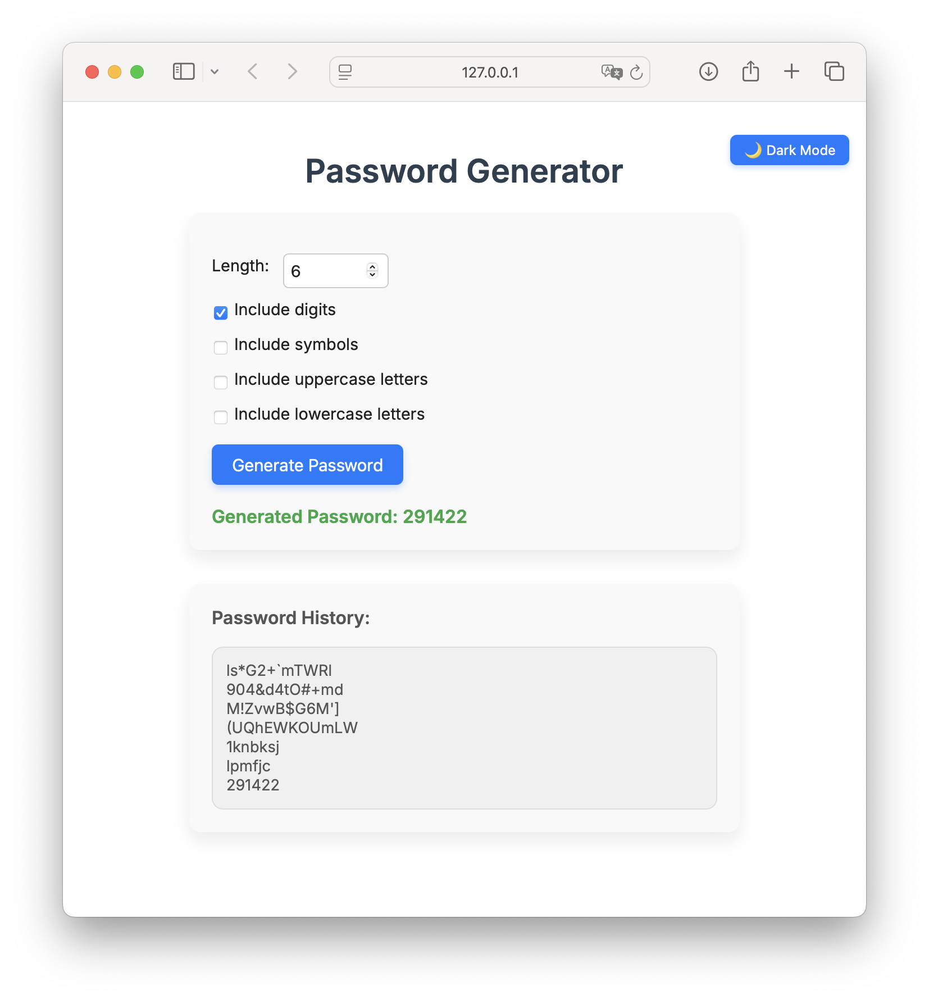
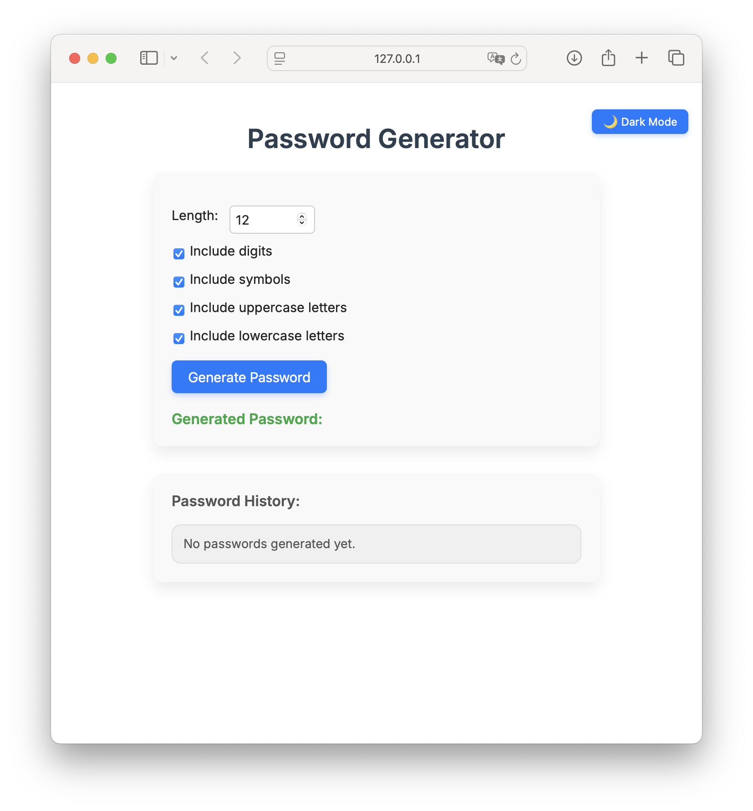
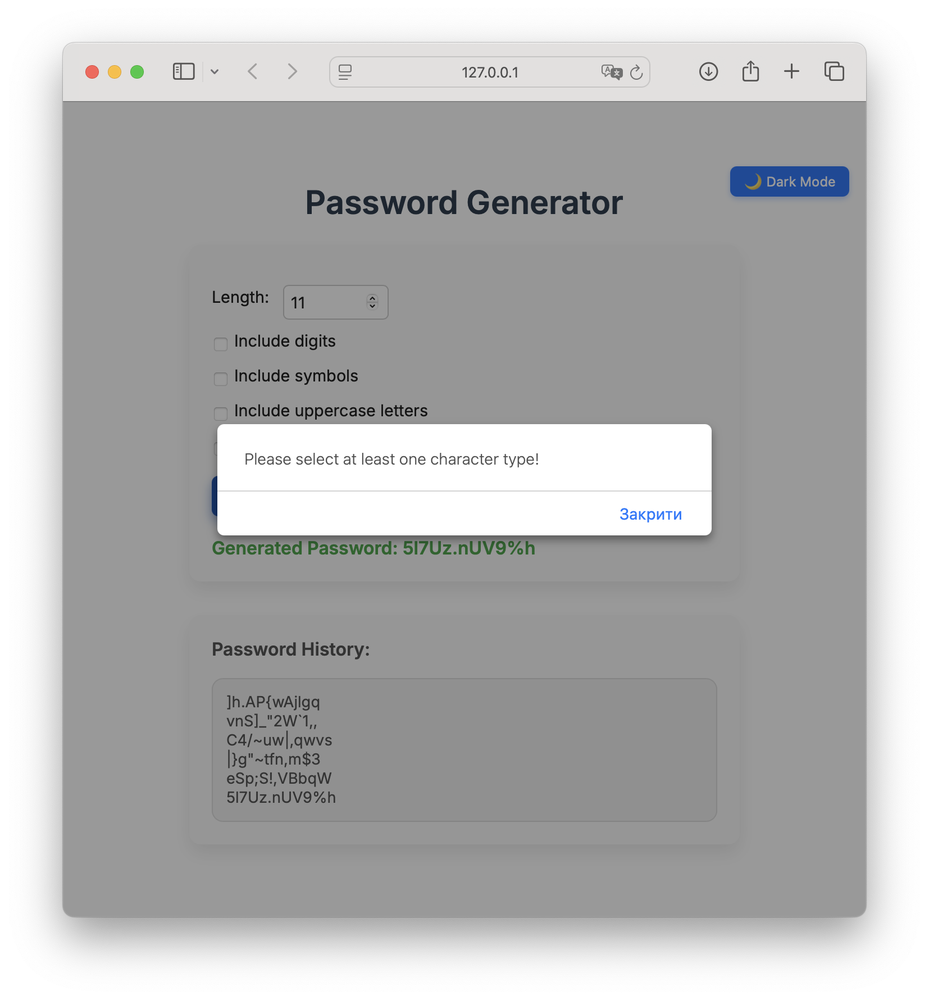

# Курсова робота: Методології та технології розробки програмного забезпечення
### Проєкт: Генератор паролів 

**Виконала:** Юхненко Віолетта

---

## 1. Клонування репозиторію

```bash 
git clone https://github.com/wiiiolettaaaaa/CourseworkMTRPZ.git
cd CourseworkMTRPZ
```

## 2. Швидке встановлення та запуск тестів

Завдяки налаштованій автоматизації через `Makefile`, ви можете встановити залежності та запустити тести однією командою з кореня репозиторію:

```bash
make setup
make test
```

Або запустити вручну через стандартний покроковий запуск:
```bash
cd password-generator
python3 -m venv .venv
./.venv/bin/pip install -r requirements.txt pytest
./.venv/bin/pytest
```

## 3. Автоматичне тестування через GitHub Actions

При кожному коміті у гілку `main` тести запускаються автоматично у GitHub Actions. Щоб переглянути результати:
1. Перейдіть у [репозиторій на GitHub](https://github.com/wiiiolettaaaaa/CourseworkMTRPZ).
2. Відкрийте вкладку **Actions**.
3. Виберіть останній запуск та перегляньте логи виконання.

## 4. Запуск проєкту через Docker

Для запуску вебзастосунку локально в контейнері:

```bash
cd password-generator 
docker compose down
docker compose up --build
```

Після цього відкрийте у браузері посилання, що з'явиться в терміналі (зазвичай `http://localhost:5000`).

---

## Інтерфейс та робота програми

На сайті можна обрати бажану довжину пароля та налаштувати вміст (цифри, великі літери, малі літери, спеціальні символи):

| Головний екран | Налаштування генерації | Результат роботи |
| :---: | :---: | :---: |
|  |  |  |